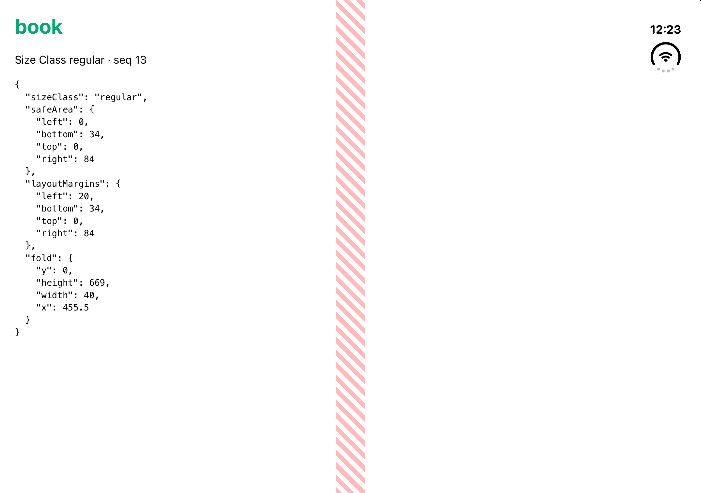

# Host integration

This guide is for the developer of the native Host app. It shows how to attach a Bridge to a WKWebView and what the Bridge then does on its own. The web side is covered in [CSS reference](css.md) and [JS reference](js.md).

## Add the package

Add the `Foldable` library with SwiftPM by git URL (`https://github.com/apaonum/foldable`). The package supports iOS 17 and later. Fold detection needs iOS 27.1. On earlier versions the Bridge sends a valid snapshot with `fold: null`, so you need no availability checks. Building it needs the iOS 27.1 SDK (Xcode 27.1).

## Attach the Bridge

1. Lay the WKWebView out edge-to-edge in its view controller's `view`.
2. Set `scrollView.contentInsetAdjustmentBehavior` to `.never`.
3. Call `Bridge.attach(to:)`.
4. Load the page.

```swift
import Foldable
import UIKit
import WebKit

final class HostViewController: UIViewController {
  private let webView = WKWebView(frame: .zero, configuration: WKWebViewConfiguration())

  override func viewDidLoad() {
    super.viewDidLoad()
    webView.frame = view.bounds
    webView.autoresizingMask = [.flexibleWidth, .flexibleHeight]
    webView.scrollView.contentInsetAdjustmentBehavior = .never
    view.addSubview(webView)

    Bridge.attach(to: webView)
    webView.load(URLRequest(url: URL(string: "https://example.com/")!))
  }
}
```

The Bridge reports geometry in CSS px over the WKWebView's bounds. If the web view is inset from its view controller's view, or if WebKit adjusts the scroll view's content insets, the Fold, safe area, and layout margins land in the wrong coordinate space. The page also needs a viewport whose layout width equals the web view width:

```html
<meta name="viewport" content="width=device-width, initial-scale=1, viewport-fit=cover" />
```

`examples/ios-host` is a working Host. Its README explains how to run it on the iPhone Duo Simulator.



## What `attach(to:)` does

`Bridge.attach(to:)` is the only public API. It returns the `Bridge` (discardable) and is idempotent: a second call on the same web view returns the Bridge already attached. Each WKWebView gets its own Bridge, so several scenes or web views each get their own state. The web view retains its Bridge, and the Bridge holds the web view weakly, so the Bridge goes away with the web view.

Attach before the first load. A page loaded before `attach(to:)` has no bootstrap, so pushes to it fail without effect until the next navigation.

On attach, the Bridge:

1. Reads the native inputs and builds the first snapshot.
2. Adds the seed user script.
3. Installs a forwarding proxy as the web view's `navigationDelegate`.
4. Installs the change hooks on `WKWebView` (once per process).
5. Registers for `horizontalSizeClass` trait changes on the web view.

### The seed

The seed is a `WKUserScript` at `.atDocumentStart`, main frame only, in the `.page` content world. It holds the bundled bootstrap followed by `window.__foldableBridge.receive(<current state>)` with `seq` 1. So the first paint of every page already has the current Fold and Size Class as CSS.

When the state changes, the Bridge replaces the seed. It reads `userScripts`, calls `removeAllUserScripts()`, and re-adds your scripts in their original order with the new seed last. It finds its old seed by object identity, never by content. Your scripts keep their relative order, including scripts you add after `attach(to:)`.

Don't replace, remove, or re-inject the bootstrap yourself. The Bridge only ever installs the bootstrap it ships with, so the bootstrap and the Bridge can't drift apart. A copy you inject can. Calling `removeAllUserScripts()` yourself also removes the seed until the next state change.

Iframes get no seed and no pushes.

### Change detection

iOS has no Fold-change notification, and a Fold activating changes neither the bounds nor the traits. The Fold flips in a layout pass of the window's root view, which the web view sits out. The Bridge re-reads the native inputs on these signals:

- `WKWebView.layoutSubviews`
- `WKWebView.safeAreaInsetsDidChange`
- a `horizontalSizeClass` trait change on the web view

On iOS 27.1 and later the `layoutSubviews` hook also reads the division regions inside the pass. UIKit then lays the web view out again when a region flips, so the hook fires for the Fold change too. See [ADR 0003](adr/0003-read-the-division-regions-inside-layout.md).

You don't forward any callback. All signals in one run-loop turn produce one read and at most one push. The Bridge compares the new snapshot with the last one it sent and sends nothing if they are equal. It never delays or predicts a change.

A Host can't subclass its web view after the fact, so the Bridge exchanges the implementations of `layoutSubviews` and `safeAreaInsetsDidChange` on the `WKWebView` class. It does this once, on the first `attach(to:)`, with the public Objective-C runtime functions `class_addMethod`, `class_replaceMethod`, and `method_exchangeImplementations`. If `WKWebView` only inherits a method, the Bridge first adds an override to `WKWebView`, so `UIView` itself is never changed. The exchanged methods call the original implementation first. A web view with no Bridge then pays one associated-object lookup per call. If your app also swizzles these two methods on `WKWebView`, each swizzle wraps the one installed before it. If either method is missing at runtime, the Bridge exchanges nothing, logs it in debug builds, and falls back to KVO on the web view's `frame` and `bounds` plus the trait change. It doesn't crash, but it then misses a Fold that activates with no size change until the next signal. See [ADR 0002](adr/0002-swizzle-wkwebview-change-signals.md).

### Navigation and `navigationDelegate`

A page that commits while the state is changing can carry an older seed. So the Bridge pushes the current state after every `didCommit`. To see `didCommit`, it puts a forwarding proxy in `navigationDelegate`:

- Set your own `navigationDelegate` before or after `attach(to:)`. The Bridge observes the property and wraps whatever you set.
- The proxy forwards every `WKNavigationDelegate` method your delegate implements, `didCommit` included, unchanged.
- Reading `webView.navigationDelegate` back returns the proxy, not your object. Don't compare it with `===` to your delegate.
- The proxy holds your delegate weakly, the same as `WKWebView` does. Keep your own strong reference to it.

### Native inputs

| Snapshot field  | Native source                                                                                                                                  |
| --------------- | ---------------------------------------------------------------------------------------------------------------------------------------------- |
| `fold`          | The first active region of `reservedRegions(kind: .division)`, which includes its 20 pt margins. `null` when none is active or below iOS 27.1. |
| `sizeClass`     | The web view's `traitCollection.horizontalSizeClass`. Anything other than `.regular` is `compact`.                                             |
| `safeArea`      | The web view's `safeAreaInsets`.                                                                                                               |
| `layoutMargins` | `layoutMargins` of the `view` of the first view controller up the responder chain. Zero insets if there is none.                               |

`WKWebView.layoutMargins` leaves out the system minimum margin, which is why the Bridge reads the owning view controller's view. When `pageZoom` isn't 1, the Bridge divides every value by it. The Bridge never sends a Posture and never reads the hinge status or angle. The page derives Posture from the Fold.

The Bridge uses only public UIKit, WebKit, and Objective-C runtime API.

## Bridge Contract v1

This section is reference for debugging. Pages use [`@foldablejs/core`](js.md) instead of the global.

The bootstrap defines `window.__foldableBridge` as a non-enumerable property:

| Member              | Meaning                                                                       |
| ------------------- | ----------------------------------------------------------------------------- |
| `version`           | `1`.                                                                          |
| `state`             | The last snapshot received, without `seq`. `null` before the first `receive`. |
| `seq`               | The `seq` of the last snapshot applied. `0` before the first `receive`.       |
| `receive(snapshot)` | Applies a snapshot: `{ fold, sizeClass, safeArea, layoutMargins, seq }`.      |

A snapshot is always the full state. Geometry is in CSS px with physical edges:

```ts
type Rect = { x: number; y: number; width: number; height: number };
type Insets = { top: number; right: number; bottom: number; left: number };
type BridgeSnapshot = {
  fold: Rect | null;
  sizeClass: 'compact' | 'regular';
  safeArea: Insets;
  layoutMargins: Insets;
  seq: number;
};
```

Pushes are `callAsyncJavaScript("window.__foldableBridge.receive(s)")` calls in the `.page` content world.

### `seq`

- The seed always carries `seq` 1. The global starts at `seq` 0, so the seed always applies on a fresh page.
- The Bridge keeps one counter per web view. Each push takes the next value, starting at 2. The counter never resets, across reloads and navigations.
- Every push increments `seq`, including the push after `didCommit`, which may repeat an unchanged state.
- `receive` drops a snapshot whose `seq` is less than or equal to the current `seq`. Otherwise it stores the state and `seq`, writes the CSS, and dispatches the internal `__foldablebridgechange` event on `window` before it returns.

So on a new page, the seed applies first and the `didCommit` push, which carries a higher `seq`, applies after it. A push that arrives late from before a reload can't overwrite the newer state.

### Version skew

The bootstrap and the Bridge always ship together. The only seam is between the bootstrap and the page's `@foldablejs/core`, which may be older or newer. Within v1 the contract is additive only, and the core parses each snapshot:

- It ignores unknown fields, including a `posture` field.
- It reads an unknown `sizeClass` as `compact`, and replaces a missing one with the 520 px rule the `fallback` source uses.
- It replaces a missing or invalid `fold` with `null`, a missing or invalid `safeArea` with the `env(safe-area-inset-*)` value, and missing or invalid `layoutMargins` with the approximation the `fallback` source uses.
- If `version` isn't `1`, it ignores Bridge state and reports `source: 'fallback'`. It still re-writes its own CSS after every bootstrap write.

The global name, its members, the event name, every `--foldable-*` name and unit, and every `data-foldable-*` name and existing value are frozen in v1.

## Keep the bootstrap in sync

`Sources/Foldable/Resources/bootstrap.js` is built from `packages/core` and committed ([ADR 0001](adr/0001-commit-built-bootstrap-for-spm.md)), because SwiftPM can't run an npm build. After you change the core, run `pnpm bootstrap:sync` and commit the result. CI fails on a stale copy.
