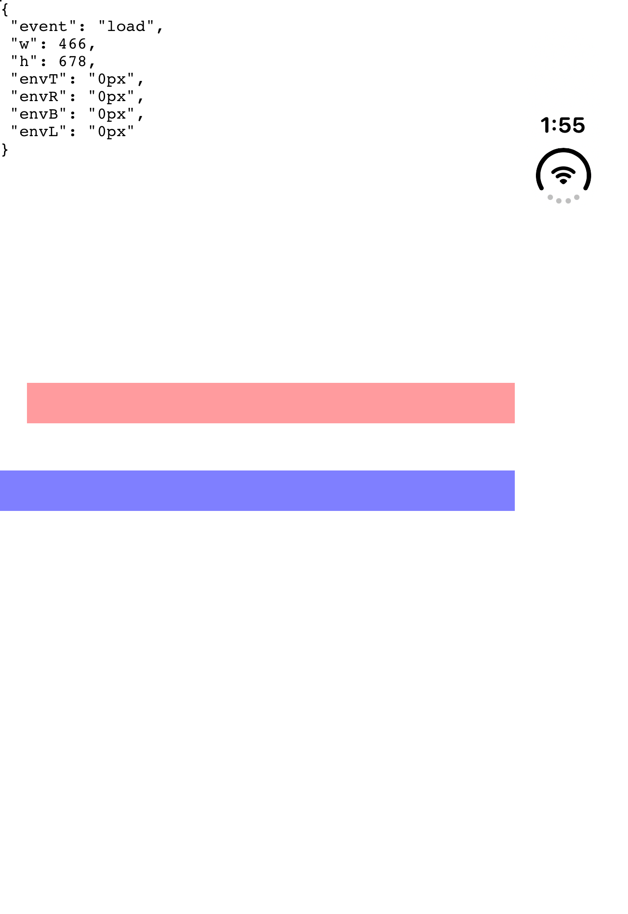
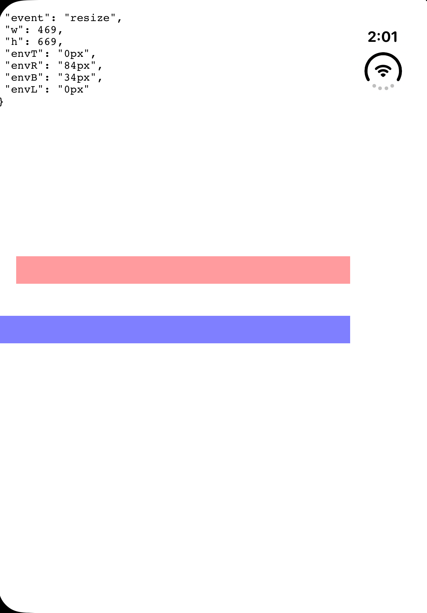
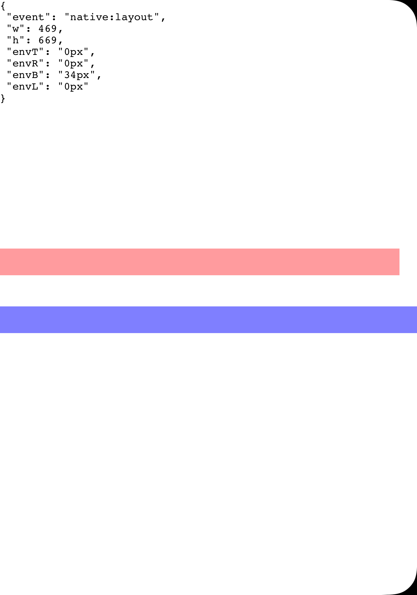

# Safe-area bar probe: the vertical status column, safe area, and layout margins

Run 2026-10-12 on Xcode 27.1 RC (27A9275), iOS 27.1 Simulator, device `iPhone Duo`. Postures and Split View were set by hand in Device Hub. Probe source: [`safe-area-bar-probe/main.m`](safe-area-bar-probe/main.m), built like the [simulator probe](simulator-probe.md#build) (add `-framework CoreGraphics`). Raw log: [`log.txt`](safe-area-bar-probe/log.txt).

Answers [Probe whether the outer display's vertical bar shows up in WKWebView safeAreaInsets](https://github.com/apaonum/foldable/issues/21), raised by forum thread 848006 in the [forum Q&A findings](https://github.com/apaonum/foldable/blob/research/duo-forum-qa/docs/research/duo-forum-qa.md).

The probe Host is an edge-to-edge WKWebView (`viewport-fit=cover`, `contentInsetAdjustmentBehavior = .never`). It logs the root view's `safeAreaInsets`, `layoutMargins` and `systemMinimumLayoutMargins`, the same values on the WKWebView and on a `preservesSuperviewLayoutMargins` child, and the page's `env(safe-area-inset-*)`. In the screenshots, the red strip is native (`layoutMarginsGuide`) and the blue strip is the page (`left/right: env(safe-area-inset-*)`).

## Findings

### The vertical bar is the system status column, fixed to the screen's trailing edge

It holds the clock and status icons, is 84 pt wide, and sits on the right edge of the screen in landscape, the outer display, and Split View alike. It does **not** move to the leading edge: in Split View it belongs to whichever app is on the right.

| State | Window | `safeAreaInsets` | `systemMinimumLayoutMargins` | `layoutMargins` (root view) | Page `env()` |
|---|---|---|---|---|---|
| Outer display, portrait | 466×678 | r84 b34 | lead20 trail0 | l20 r84 b34 | r84 b34 |
| Inner, flat, full screen, landscape | 951×669 | r84 b34 | lead20 trail0 | l20 r84 b34 | r84 b34 |
| Inner, Split View, app on the **right** | 469×669 | r84 b34 | lead20 trail0 | l20 r84 b34 | r84 b34 |
| Inner, Split View, app on the **left** | 469×669 | b34 | **lead0 trail20** | **l0 r20** b34 | b34 |

  

### Where the bar is, it is in `safeAreaInsets`, and the page sees it

- The root view, the window, and the WKWebView all report `r84`. `env(safe-area-inset-right)` is `84px` once the first layout pass has run.
- Next to the bar, `systemMinimumLayoutMargins` adds **0** on top of the safe area. On the opposite side it adds 20. This is the asymmetric margin quoted from the `contentMargins(for: .container)` docs.

### On the left of Split View, the native margin is asymmetric with no safe-area inset to signal it

- The left app has no bar and a zero horizontal safe area. Its system minimum flips to **leading 0, trailing 20**: flush against the screen's leading edge, 20 pt toward the divider.
- The page sees `env()` 0 on both sides. Nothing it receives tells it which half it is in, so it can't rebuild `l0 r20`.
- `max(env(safe-area-inset-*), 20px)` matches native in the first three states but puts 20 pt on the leading edge here, where native UI uses 0. This matches the forum report of "too much padding on the leading edge" in Split View. What the poster described as "the bar on the leading edge" did not reproduce as an inset.
- Safari on the left draws a column of controls on its leading edge. That is Safari's own UI: the probe in the same position reports no leading inset.

### `WKWebView.layoutMargins` leaves out the system minimum

The WKWebView's own `layoutMargins` equal its safe area (`l0 r84`), while a plain child with `preservesSuperviewLayoutMargins` gets `l20 r84`. A Bridge that wants native margins must read the host view's `layoutMargins` (or `systemMinimumLayoutMargins` plus `safeAreaInsets`), not the WKWebView's.

### Transitions lag but converge

- On unfold and on Split View moves, the safe area can read `r0` for a few frames before `r84` lands. The system minimum shows a transient `lead0 trail20` in that window too.
- The WKWebView's `safeAreaInsets` trail the root view's by one layout pass. `env()` trails that by ~120 ms (`r84` at 14:05:03.801, `r0` at .920 after moving to the left).
- `env()` reads 0 in the page's first script run, as in the [simulator probe](simulator-probe.md).

### Fold

In Split View the inactive Fold sits on the app's edge facing the other app (x −26.5…13.5 on the right app, then clipped to 0…13.5). A stale out-of-bounds frame (`x 455.5`) showed up for one layout pass after the move to the left.

## Run 2: rotation and Postures

Same build and device, run 2026-10-12 16:00. Raw log: [`log-postures.txt`](safe-area-bar-probe/log-postures.txt).

| State | Window | `orient` | Size Class | Fold (`division`) | `safeAreaInsets` | `systemMinimumLayoutMargins` | `layoutMargins` (root view) | Page `env()` |
|---|---|---|---|---|---|---|---|---|
| Outer display, landscape | 678×466 | 4 | compact | none | r84 b34 | lead20 trail0 | l20 r84 b34 | r84 b34 |
| Inner, book | 951×669 | 4 | regular | active, x 455.5, 40×669 | r84 b34 | lead20 trail0 | l20 r84 b34 | r84 b34 |
| Inner, tabletop | 669×951 | 2 | regular | active, y 455.5, 669×40 | t82 b34 | lead20 trail20 | t82 l20 r20 b34 | t82 b34 |
| Inner, book, Split View, app on the **left** | 469×669 | 4 | **compact** | active, x 455.5, 13.5×669 (clipped) | b34 | lead0 trail20 | l0 r20 b34 | b34 |

- The outer display's bottom inset is 34 in landscape, the same as in portrait.
- An active Fold adds nothing to the safe area or the layout margins. In book they match flat full screen exactly.
- In tabletop, the status area moves to the top edge (occlusion `{535,0} 134×82`), so the 84 pt trailing inset becomes an 82 pt top inset and both horizontal system minimums are 20. Device Hub put the device in `orient=2` (portrait upside-down). Upright portrait was not captured.
- Book plus Split View gives an active Fold with compact Size Class. The probe sees the 13.5 pt of the Fold that falls inside its window. Margins match the flat Split View left-app row from run 1. During the move, two layout passes reported `x −26.5`, which is the right app's frame, before the final `x 455.5` frame arrived.

## Probe caveat

The `win=` field in the log (window frame in screen coordinates) is wrong: it reads `{0,0}` on both halves. Use the Fold frame to tell the halves apart.

## Not covered

- Inner display in upright portrait (`orient=1`). Run 2 captured only upside-down (`orient=2`).
- Book plus Split View with the app on the right.
- Real hardware.
